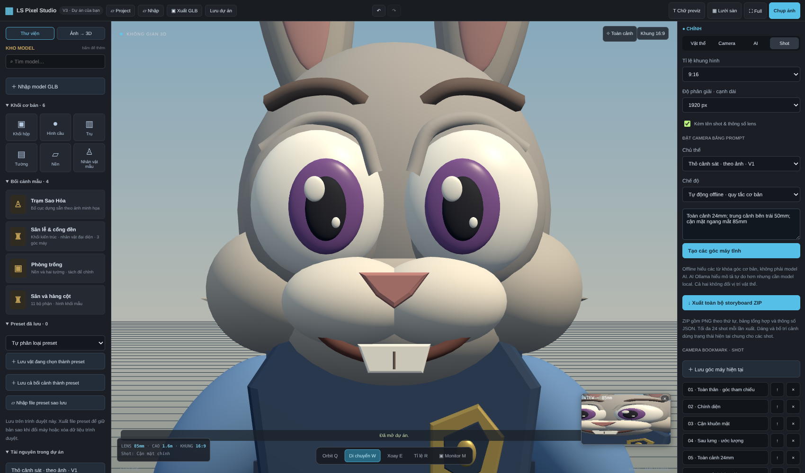
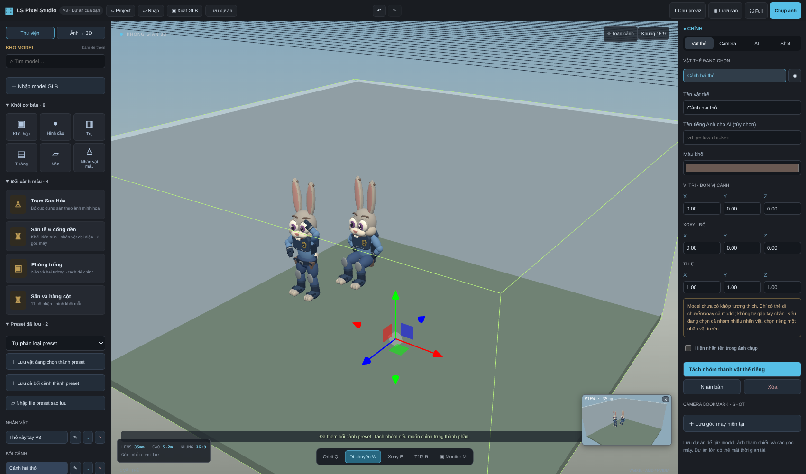

# LS Pixel Studio V3 — hướng dẫn sử dụng

## Cài / cập nhật

Đóng tool và CMD cũ. Giải nén V3, copy **nội dung bên trong** đè vào thư mục bản cũ, thay file trùng. Giữ `.venv`, `.cache`, `outputs`, `.data`. Mở `START-STUDIO.bat`; cần Python 3.11 64-bit. Không đổi thư viện Python so với V2, không cần cài lại TripoSR. Các thư viện JavaScript đã đóng gói, không cần npm để dùng tool.

Luôn dùng cùng trình duyệt và địa chỉ **http://127.0.0.1:8090**. Preset lưu trong IndexedDB của địa chỉ đó; `localhost` và `127.0.0.1` có hai kho khác nhau. Cập nhật file không xóa kho, nhưng xóa dữ liệu trình duyệt/đổi profile/đổi máy có thể làm mất; xuất `.lspreset` để sao lưu.

## 1. Nhập và chỉnh mô hình

- Bấm **Nhập** hoặc **Nhập model GLB**, chọn file và bấm lên sàn để đặt. GLB được chuẩn hóa cạnh dài nhất khoảng 2 đơn vị; chỉnh tỉ lệ nếu cần.
- Bấm vật thể hoặc tên trong bảng phải: trục hiện ngay. W di chuyển, E xoay, R tỉ lệ; Q orbit. Có nhập tọa độ/góc/tỉ lệ, nhân bản, xóa, ẩn và tách nhóm.
- Chuột trái orbit, phải pan, cuộn zoom. Hoàn tác bằng Ctrl+Z hoặc nút ↶, làm lại bằng Ctrl+Shift+Z / ↷. Lịch sử giữ tối đa 10 trạng thái; không hoàn tác thay đổi kho preset IndexedDB.
- Project mở `.ls3d` **thay cảnh hiện tại**; lưu dự án cũ trước. GLB/preset thêm vào cảnh hiện tại.

## 2. Preset nhân vật, đồ vật và bối cảnh

- Chọn vật/nhân vật → kho trái **Preset đã lưu** → chọn phân loại nếu muốn → **Lưu vật đang chọn thành preset** → đặt tên.
- **Lưu cả bối cảnh thành preset** giữ toàn bộ hình học, vật liệu, tư thế và bố trí hiện tại. Camera/bookmark lưu riêng trong dự án `.ls3d`.
- Bấm tên preset nhân vật/đồ vật rồi bấm lên sàn để thêm bản sao. Preset bối cảnh được thêm ngay theo tọa độ đã lưu. Các bản sao có ID/hình học/vật liệu riêng, chỉnh một bản không đổi bản khác.
- ✎ đổi tên; ↓ tải file `.lspreset`; × xóa khỏi kho (không xóa vật đang nằm trong cảnh).
- **Nhập file preset sao lưu** phục hồi `.lspreset`. Không dùng nút này cho `.ls3d`, GLB hoặc bố cục JSON.
- Tìm kiếm ở kho model cũng lọc các preset. Chưa có thumbnail tự động hoặc đồng bộ cloud; kho hiện lưu trên trình duyệt này.

## 3. Tạo dáng

Nhân vật mẫu V2/V3 và Rabbit Officer V1 dùng khớp tương thích. **V3 tự nhận khớp qua lớp bọc GLB**, không cần tách hai lần như V2. Nếu đang chọn cả nhóm nhiều nhân vật, cần chọn riêng một nhân vật (có thể tách nhóm bối cảnh trước).

- Chọn nhân vật, mở **Tư thế** ở bảng Vật thể.
- Có đứng, ngồi, ngồi xổm, vẫy tay, chỉ tay, giơ hai tay, bước đi và quỳ một gối.
- Mở **Chỉnh riêng trái/phải và đầu** để chỉnh từng tay, khuỷu, hông, gối, quay/cúi đầu. Trái/phải theo mặt chính diện model.
- Slider chung chỉnh cả hai bên và xóa phần ghi đè trái/phải của khớp đó. Slider riêng chỉ đổi một bên.
- Lưu nhân vật đã chỉnh thành preset, ví dụ “Thỏ vẫy tay”, để dùng lại cả model và dáng.
- Đây là **dáng tĩnh**, không có animation vẫy tay/đi bộ, IK hay tự chống xuyên người. Chỉnh vị trí/độ cao nếu ngồi ghế hoặc gối làm chân lệch sàn.
- Mesh TripoSR hoặc rig Mixamo/GLB bất kỳ không tự thành rig tương thích. Tool hiện thông báo khi chưa nhận được khớp; không tự skin/auto-rig. Các model procedural dùng các nhóm khớp, không phải skeleton biến dạng mượt.

## 4. Camera tĩnh, ống kính và cảm biến

- Đặt góc bằng editor, sang **Camera → Từ góc hiện tại** hoặc **Lưu góc máy hiện tại**. Đặt tên để tạo camera/shot độc lập.
- Chọn camera trong danh sách. **Xem shot** đưa editor về góc đó. Sau đó orbit editor không làm camera đã lưu thay đổi.
- **Cập nhật shot** ghi lại góc editor hiện tại vào camera đang chọn.
- Nhập tọa độ camera và điểm nhìn, hoặc bấm **Kéo camera**. Tool lùi editor ra để thấy camera/gizmo; W/E để kéo/xoay. Click lại vật thể để quay về chỉnh vật thể.
- Chọn 18/24/35/50/85/135/200mm hoặc nhập 12–300mm. Chọn Full Frame, APS-C, Micro 4/3, Super 35. Góc nhìn ngang/dọc tự tính theo lens, cảm biến và crop khung ảnh. Chưa có fisheye/anamorphic, DOF khẩu độ hoặc biến dạng ống kính.
- Trong **Shot**, chọn 16:9, 4:3, 2.39:1, 1:1 hoặc 9:16, cạnh dài 1280/1920/3840px. Các thông số này ghi vào camera đang chọn; các shot khác giữ thông số riêng.
- **Monitor** hiển thị camera được chọn với đúng tỉ lệ của nó. Góc editor có thể rộng/hẹp khác monitor; ảnh xuất theo camera/monitor. Nếu chưa chọn camera, ảnh dùng góc editor hiện tại.
- Camera/bookmark và thông số được lưu trong `.ls3d`; GLB hình học không chứa danh sách shot của editor.

## 5. Prompt góc máy

Trong tab **Shot**, chọn chủ thể và một trong hai chế độ:

**Tự động offline — quy tắc cơ bản:** không cần Ollama, không phải model AI. Nhận từ khóa toàn cảnh/trung cảnh/cận mặt/đặc tả, trái/phải/sau lưng/cao/thấp và tiêu cự mm. Nên tách shot bằng dấu `;` hoặc xuống dòng; cũng nhận dấu phẩy trước loại góc.

Ví dụ: `Toàn cảnh 24mm; trung cảnh bên trái 50mm; cận mặt ngang mắt 85mm`.

Tool tính khoảng cách theo kích thước chủ thể và trường nhìn, ưu tiên khớp đầu khi cận mặt nhân vật tương thích. Vẫn cần kiểm tra vật có bị che, hướng mặt, bố cục và chỉnh lại.

**AI Ollama local:** gửi prompt và tên/ID chủ thể đến model local `qwen2.5vl:3b`. Mở Ollama và chạy `SETUP-VISION-V2.bat` để tải model. Có thể đặt `LS_VISION_MODEL` cho model local tương thích khác. AI trả mô tả shot có giới hạn số/loại/thông số; tool tự tính tọa độ. Không chạy code do AI trả về. Khi AI lỗi, tool báo lỗi, **không tự thay bằng kết quả offline rồi gọi đó là AI**.

Camera không đổi vị trí, tư thế hoặc hình dáng các vật thể. Prompt hiện tạo camera tĩnh, không có chuyển động camera.

## 6. Xuất storyboard

- Các shot được đánh số theo danh sách bookmark. ↑ đẩy shot lên một vị trí, × xóa, bấm tên để xem.
- **Chụp ảnh** xuất camera đang chọn (hoặc góc editor nếu chưa chọn), đúng tỉ lệ/lens/độ phân giải. Bật/tắt tên shot và thông số trong ảnh ở tab Shot.
- **Xuất toàn bộ storyboard ZIP**: từng PNG có số thứ tự, `storyboard.png` dạng contact sheet và `shots.json` chứa thông số camera. Tối đa 24 shot mỗi lần. Trạng thái cảnh/tư thế **hiện tại** dùng chung cho toàn bộ shot, chưa có snapshot tư thế riêng từng shot.
- Lưới, viền chọn, gizmo và helper camera không đưa vào ảnh. Nhãn previz bật trên vật thể sẽ được vẽ trong ảnh.
- Các thao tác bị khóa trong lúc xuất để tránh đổi cảnh giữa các frame. Lưu `.ls3d` nếu muốn chỉnh tiếp toàn bộ dự án.

## 7. Ảnh → 3D và điều kiện AI

V3 hoàn thiện editor/preset/camera/storyboard; **không giải quyết việc tái tạo mọi ảnh thành model chính xác**.

- Bố cục mô phỏng và nhân vật đại diện theo ảnh: dùng Ollama thị giác local, hoặc nhập JSON do ChatGPT/Claude viết. Thư viện hình khối/kiểu nhân vật vẫn hữu hạn, không sao chép đúng mặt/trang phục/kiến trúc tùy ý.
- TripoSR: ảnh một vật tách riêng → mesh; không có rig tự động và không hợp ảnh cả cảnh.
- Mesh độ sâu: thử nghiệm, chỉ gồm bề mặt nhìn thấy, phần khuất chưa dựng. Không phải scene đầy đủ 360°.
- **Kiểm tra AI local** trong tab AI kiểm tra kết nối Ollama, tên model và sự hiện diện virtualenv TripoSR; không phải kiểm thử inference.
- Cloud phát triển bị chặn Hugging Face/Ollama registry HTTP 403; chưa xác minh inference thực tế trên Windows/RX 580. Chưa đo FPS hoặc bộ nhớ thực tế trên máy người dùng. RX 580 không được cam kết tăng tốc AI; có thể chạy CPU chậm và cần nhiều RAM.

## Kiểm chứng V3

15 test Python đạt: backend, Unicode Windows giả lập, validation/protocol AI, ghép cảnh/depth với model giả lập. Chromium đã kiểm tra: GLB thỏ tự nhận rig, pose trái/phải, preset tồn tại sau reload, đổi tên/xuất/xóa/nhập sao lưu, bản sao độc lập, preset cả cảnh; camera prompt offline ba shot, lens/cảm biến, camera không bị đổi khi orbit editor, kéo camera thật bằng trục, lưu/mở camera, PNG dọc, ZIP bảy shot/contact sheet/metadata và lỗi AI không tạo fallback giả. ZIP/PNG/GLB được đọc lại bằng Python. Kiểm thử giao thức AI dùng phản hồi giả lập; chưa có xác nhận inference AI thật.

### Chạy lại kiểm tra trong môi trường phát triển

Backend: dùng Python trong virtualenv AI đã cài, chạy `python -m unittest discover -s scene-studio/tests -v` từ gốc repository. Browser: cần Node và Playwright/Chromium (chỉ cho kiểm thử, không cần để sử dụng app); mở server ở cổng 8090, chạy `node scene-studio/tests/browser_presets.cjs` và `node scene-studio/tests/browser_cameras.cjs`. Kết quả thử lưu trong thư mục tạm `ls-studio-v3-tests`. Trong cloud dùng runtime Chromium headless có sẵn và đã chạy các kiểm tra này; camera gizmo và monitor còn có kiểm tra tương tác riêng.
