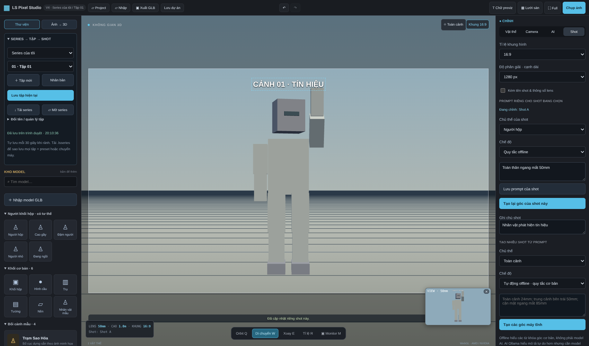

# LS Pixel Studio V4 — Series, tập và storyboard

V4 gộp trình dựng cảnh, kho preset, pose tĩnh, camera/ống kính và storyboard với quản lý **Series → Tập → Shot**. Có bộ khởi động tự chuẩn bị Python/bộ AI theo máy Windows x64. Hai bộ tài nguyên Rabbit Officer V1 và Outpost7 V1 nằm trong `scene-studio/assets`.

## Mở lần đầu

1. Giải nén toàn bộ `LS-Pixel-Studio-V4-Full.zip` vào thư mục có quyền ghi, ví dụ `D:\LS-Pixel-Studio-V4`. Không chạy ngay bên trong ZIP; tránh Program Files/ổ mạng.
2. Chạy **START-STUDIO.bat** (hoặc START-FULL-V4.bat). Không phải start-local.bat của Voice Studio.
3. Bộ khởi động tìm Python **3.11 64-bit**; thiếu thì tải trình cài chính thức, kiểm tra chữ ký và cài cho tài khoản hiện tại. Tiếp đó kiểm tra GPU, chuẩn bị PyTorch/dependencies và cache model 3D; tìm/cài Ollama và tải model thị giác/camera `qwen2.5vl:3b`.
4. Giữ cửa sổ CMD mở. Lần đầu cần Internet, nhiều GB dữ liệu và thời gian tải; nên dành khoảng 25 GB dung lượng trống. Windows có thể yêu cầu quyền cài Microsoft Visual C++ runtime. Nếu mạng hoặc cài AI lỗi, thông báo giữ nguyên trong CMD và editor vẫn có thể mở với chức năng offline.
5. Dùng cùng trình duyệt và địa chỉ **http://127.0.0.1:8090** để truy cập kho dữ liệu đã lưu.

**START-EDITOR-ONLY.bat** chỉ chuẩn bị Python rồi mở editor, bỏ qua cài/tải AI nặng. Dùng được preset, model GLB, pose, camera tay, prompt theo quy tắc offline và xuất storyboard. **INSTALL-FULL-V4.bat** chỉ chuẩn bị các bộ AI, chưa mở editor.

Đây là gói mã nguồn + tài nguyên + bộ tự cài, **không phải một EXE offline đã kèm toàn bộ Python/CUDA/model**. Các file tải từ máy chủ chính thức; launcher không bỏ qua kiểm tra TLS/chữ ký trình cài. Không tự cài driver card màn hình.

## GPU trên máy khác

| Phần | Cách dùng phần cứng |
| --- | --- |
| Khung 3D / chọn-kéo vật / preview | WebGL của Chrome/Edge; phụ thuộc driver và tăng tốc phần cứng trình duyệt |
| TripoSR dựng một vật thể | NVIDIA được hỗ trợ + driver phù hợp + ít nhất 4 GB VRAM: thử CUDA bằng phép tính thật; GPU lỗi/hết VRAM có thể thử lại bằng CPU |
| AMD RX 580 / Intel / GPU không được hỗ trợ | TripoSR chạy CPU, không giả nhận CUDA hoặc DirectML |
| Ước lượng depth / segmentation thử nghiệm | Chạy CPU để giảm nhu cầu VRAM; các vật TripoSR dùng chế độ tự động |
| Ollama thị giác/camera | Ollama tự chọn backend hỗ trợ; độc lập với thiết lập PyTorch. RX 580 không được bảo đảm tăng tốc AI |

Bộ chọn wheel dùng PyTorch 2.5.1 CPU/CUDA 12.1 cho NVIDIA tương thích; kiến trúc NVIDIA 10–12 với driver Windows từ 570.65 dùng PyTorch 2.7.1 CUDA 12.8. GPU/driver ngoài phạm vi kiểm tra sẽ dùng CPU. `nvidia-smi` phải đọc được thông tin GPU; có file nvidia-smi chưa đủ để khẳng định CUDA chạy được. Cấu hình AI **Tự động** chọn mức tiết kiệm, hoặc mức cân bằng khi CUDA đã qua kiểm tra và có ≥8 GB VRAM. Người dùng vẫn có thể chọn mức tiết kiệm.

Tab **AI → Kiểm tra AI local** hiển thị báo cáo thiết bị của lần khởi động đầy đủ và tình trạng Ollama/model. Tìm thấy model hoặc phép tính CUDA thành công chưa chứng minh inference TripoSR hoàn chỉnh đã chạy thành công. Có thể đặt biến môi trường `LS_AI_DEVICE=cpu` trước khi mở tool để ép TripoSR dùng CPU; `LS_VISION_MODEL` đổi model Ollama.

## Cập nhật V3 → V4 và chép sang máy khác

- Đóng CMD/tool cũ trước khi thay file. Trước khi cập nhật, tải các dự án `.ls3d` và kho preset để sao lưu.
- Có thể giải nén nội dung V4 đè vào thư mục cũ; giữ `.cache`, `outputs`, `.data` và dữ liệu dự án. JavaScript dùng thư viện đóng gói sẵn, không cần npm.
- Lần chạy V4 đầu tiên có thể chuẩn bị lại `.venv` cũ vì bản cũ chưa có dấu nhận diện máy. Thư mục cũ được **đổi tên giữ lại** thành `.venv-old-...`, không xóa. Những lần tiếp theo trên cùng máy/path/dependencies/GPU không cài lại gói Python.
- Khi chép thư mục sang máy/path khác, launcher tạo môi trường đúng máy thay vì dùng nhầm đường dẫn Python từ máy cũ. Có thể chép kèm `photo-3d-ai/.cache` để dùng lại model đã tải; thiếu model vẫn cần Internet. Ollama lưu model theo tài khoản Windows, không nằm trong thư mục tool, nên máy khác có thể phải tải lại.
- **Kho trình duyệt không nằm trong thư mục tool.** Trên máy cũ bấm **Tải series**, mang file `.lsseries` sang máy mới rồi bấm **Mở series**. Chỉ chép thư mục phần mềm không mang theo IndexedDB.
- Nếu cần dọn dung lượng, chỉ tự xóa `.venv-old-...` sau khi đã xác nhận bản mới hoạt động và đã sao lưu dữ liệu cần giữ.

## Series → Tập → Shot

Ở đầu kho trái, chọn series và tập đang làm.

- **＋ Tập mới:** tạo tập trống, không lấy cảnh của tập hiện tại.
- **Nhân bản:** sao chép cảnh, dáng, camera, prompt và text của tập hiện tại. Chỉnh bản mới không đổi bản cũ.
- **Đổi tên / quản lý tập:** đổi tên series/tập, tạo series mới, ghi chú tập, đưa tập lên trước hoặc xóa tập (có xác nhận). Giữ ít nhất một tập trong series, tối đa 200 tập.
- **Lưu tập hiện tại:** lưu vào IndexedDB của trình duyệt. Tự lưu mỗi 30 giây khi rảnh; không lưu giữa lúc đang kéo, đặt vật, nhập thông số hoặc chạy tác vụ AI/xuất ảnh. Bấm Lưu trước khi đóng cửa sổ.
- **Tải series:** xuất `.lsseries` gồm mọi tập và kho preset của series (kèm preset cũ dùng chung từ V3). Đây là bản sao lưu để chuyển máy; vẫn cho tải file khi việc ghi vào kho trình duyệt bị lỗi/hết dung lượng.
- **Mở series:** nhập thành series mới và nhập bản sao preset của nó; giữ nguyên series cũ. Chọn lại series cũ bằng ô chọn trên cùng. File tối đa 500 MB; cảnh lớn cần nhiều RAM/dung lượng trình duyệt.
- Nút **Lưu dự án** trên thanh trên xuất `.ls3d` chỉ gồm **tập hiện tại**. **Project** mở `.ls3d` thay cảnh của tập đang mở, không mang theo các tập khác; lưu tập/dự án cũ trước.

Tải lại trang sẽ mở tập gần nhất đã lưu. Kho phụ thuộc trình duyệt/profile/origin; xóa dữ liệu trình duyệt có thể làm mất kho. `localhost:8090` và `127.0.0.1:8090` là hai kho khác nhau. File sao lưu là cách chuyển dữ liệu được hỗ trợ, chưa có đồng bộ cloud/tài khoản người dùng.

## Nhập, di chuyển và lưu preset nhân vật

**Nhập → chọn GLB → bấm lên sàn để đặt.** Sau đó chọn nhân vật, bấm **＋ Lưu nhân vật / vật thể thành preset** ngay ở bảng Vật thể. Đặt tên, preset xuất hiện trong kho trái. Có thể chọn phân loại ở phần Preset trước khi lưu. **Lưu cả bối cảnh thành preset** giữ các vật và tư thế, còn camera/text nằm trong tập/dự án.

Preset mới thuộc series hiện tại và dùng chung giữa các tập của series. Preset V3 có sẵn vẫn xuất hiện như kho cũ dùng chung. Khi chọn series khác, kho mới đổi theo series. Muốn chia sẻ sang series khác: xuất/nhập preset hoặc file kho `.lslibrary`.

Bấm tên preset để thêm bản sao, chỉnh bản sao không đổi preset hoặc các nhân vật trước. Có đổi tên, xóa, xuất từng `.lspreset`, **Sao lưu toàn bộ preset** và **Phục hồi kho preset**. Nhập sao lưu tạo bản sao, có thể có tên trùng.

Chọn vật trong khung 3D hoặc danh sách: **W** di chuyển, **E** xoay, **R** tỉ lệ, **Q** orbit; nhập tọa độ ở bảng phải. Có nhân bản, ẩn, xóa, tách nhóm và hoàn tác. Không hoàn tác thao tác xóa/đổi kho preset hoặc quản lý series/tập.

## Mẫu người hộp và tư thế

Kho **Người khối hộp** có người thường, cao gầy, đậm người, người nhỏ và đang ngồi. Mỗi mẫu có thân/đầu/tay/chân bằng hộp và khớp tương thích để chọn dáng sẵn hoặc chỉnh riêng hai bên. Dùng để bố trí crowd/storyboard, chưa có hoạt ảnh đi/chạy.

Rabbit Officer V1 có khớp tương thích; GLB nhập tự hiện bảng pose. Model mesh thông thường/TripoSR chưa có rig tự động nên chỉ di chuyển/xoay toàn bộ, không tự gập tay chân. Dùng **Lưu preset** sau khi chỉnh dáng để lưu biến thể.

## Camera, ống kính và prompt từng shot

- Lưu góc hiện tại thành shot; mỗi shot có camera riêng, lens, sensor và tỉ lệ riêng. Orbit editor không tự ghi đè camera đã lưu; **Cập nhật shot** mới lấy góc editor vào shot.
- Có chỉnh tọa độ camera/điểm nhìn, kéo camera bằng gizmo, lens preset hoặc tiêu cự 12–300 mm, cảm biến Full frame/APS-C/MFT/Super 35 và góc nhìn tính theo thông số.
- Chọn shot trong danh sách bookmark, mở tab **Shot**. Ô **Prompt riêng cho shot đang chọn** cùng **chủ thể, chế độ và ghi chú shot** được lưu với shot đó.
- **Lưu prompt** giữ yêu cầu; **Tạo lại góc của shot này** chỉ cập nhật camera shot đang chọn, giữ tên/ID, các shot khác và vị trí vật thể. Ví dụ: `Cận mặt bên trái, ngang mắt, 85mm`. Nếu đưa nhiều góc trong ô này, chỉ lấy góc đầu tiên.
- Phần **Tạo nhiều shot từ prompt** tạo thêm nhiều camera mới, ví dụ `Toàn cảnh 24mm; trung cảnh bên trái 50mm; cận mặt 85mm`.
- **Quy tắc offline** là bộ đọc từ khóa, không phải model AI. **AI Ollama local** cần model chạy thành công; lỗi được báo, không âm thầm đổi sang một kết quả “AI” giả.

Monitor là khung camera/lens/tỉ lệ dùng để xuất. Khung editor có thể khác tỉ lệ; bật **Khung camera** để đặt text đúng vùng ảnh.

## Text / ghi chú tùy chỉnh

Trong **Text / ghi chú trên ảnh → Thêm text**, nhập nhiều dòng, chỉnh màu, kích thước, căn chữ và X/Y theo %. Kéo trực tiếp chữ trong khung để đặt vị trí.

- **Cả tập:** xuất hiện ở các shot của tập đó.
- **Riêng shot đang chọn:** chỉ hiện khi xem/xuất shot đó; phải có shot trước khi chọn phạm vi này.
- **Hiện text:** bật/tắt chữ trong khung và ảnh.
- **Kèm khi xuất PNG:** cho phép để chữ hướng dẫn trong editor/monitor nhưng bỏ khỏi ảnh thành phẩm.

Text là chữ phủ lên khung ảnh, không phải mesh chữ 3D; không xuất vào GLB. Tọa độ và cỡ chữ tỉ lệ theo khung/độ phân giải. Text được lưu trong từng tập, `.ls3d` và `.lsseries`; có hoàn tác.

## Xuất storyboard

Chụp một shot hoặc xuất ZIP toàn bộ shot **của tập hiện tại**: PNG đánh số, `storyboard.png` contact sheet và `shots.json` gồm tên series/tập, lens, camera, prompt và ghi chú. Hỗ trợ 16:9, 4:3, 2.39:1, 1:1, 9:16; cạnh dài 1280/1920/3840; tối đa 24 shot/lần. Ẩn lưới/gizmo khi xuất.

Tất cả shot của một tập dùng **bố trí và pose hiện tại chung**; chưa có pose/trạng thái vật thể riêng từng shot. Có thể nhân bản tập để dựng trạng thái khác rồi xuất riêng. Chưa có hoạt ảnh camera hoặc xuất video.

## Giới hạn ảnh → 3D và kiểm thử

V4 cải tiến workflow và việc chọn phần cứng, **không nâng cấp thành tái tạo chính xác cả ảnh bất kỳ**. TripoSR ước lượng một vật; phần khuất do model đoán, chưa có rig. Luồng Ollama dựng bố cục/nhân vật dùng một thư viện mô hình đại diện hữu hạn. Depth mesh là thử nghiệm bề mặt nhìn thấy, không hoàn chỉnh phần khuất. Không thể từ các ảnh chụp giao diện kết luận phần mềm tham khảo tự sinh chính xác toàn bộ mesh.

Đã kiểm thử trên cloud Linux: 24 kiểm thử Python (GPU/installer dùng giả lập, phép kiểm tra CPU thật), browser workflow series/tập/preset/pose/prompt/text, chuyển file sang profile trình duyệt mới, xuất PNG/ZIP và regression V3. Parser PowerShell không báo lỗi cú pháp. **Chưa chạy bộ cài trên máy Windows/GPU thật, chưa xác minh inference TripoSR/Ollama thật**; cloud bị chặn tải một số tài nguyên chính thức. Không coi kiểm tra giả lập là bằng chứng chất lượng AI.

Nếu gặp lỗi: gửi ảnh toàn bộ CMD và tab AI → Kiểm tra AI local. Bản báo cáo phần cứng ở `.runtime/hardware.json`, log tác vụ trong `scene-studio/.data/<id>/engine.log`; không cần mở giao diện AI Gradio riêng trước khi dùng Studio. Studio đã chạy sẽ mở lại cửa sổ hiện có, không mở thêm server tranh cổng. Giao diện AI riêng để Gradio tự chọn cổng trống thay vì cố định 7860.
