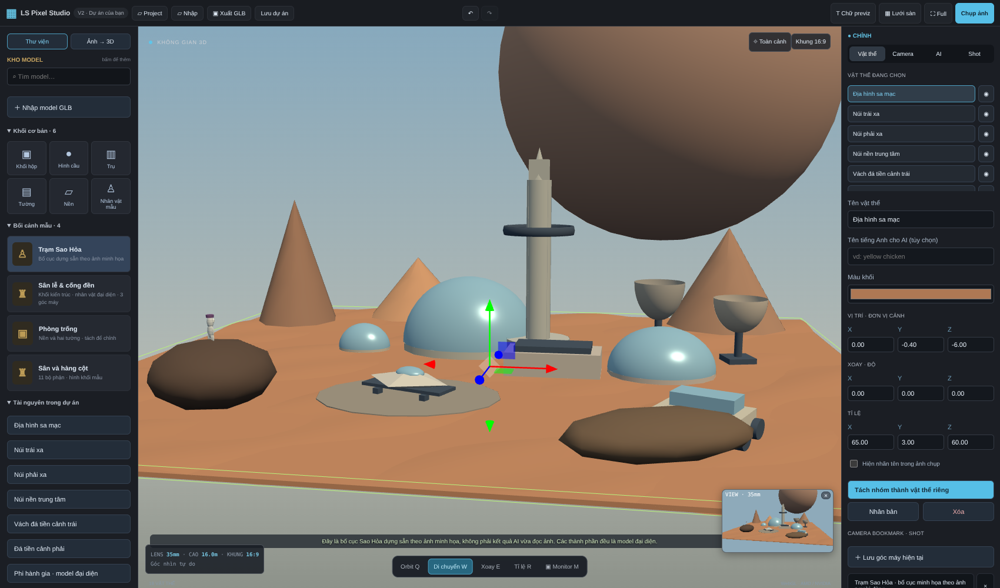
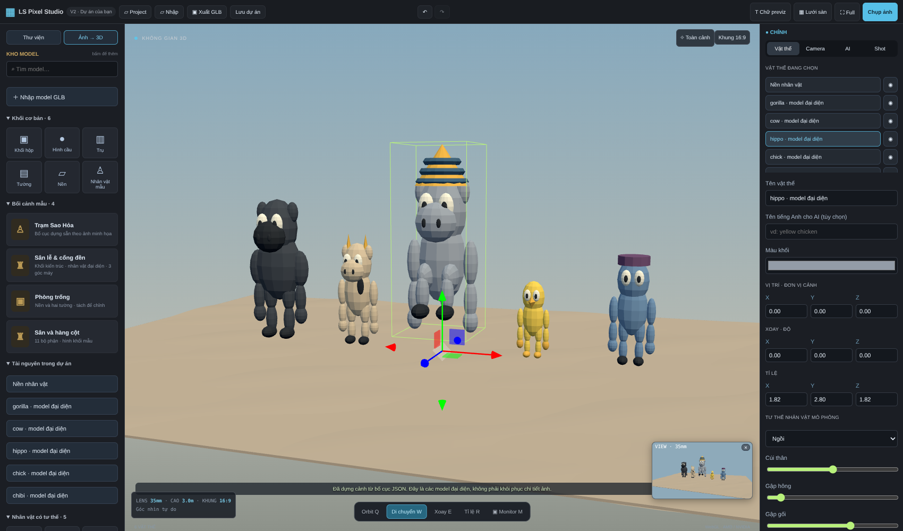
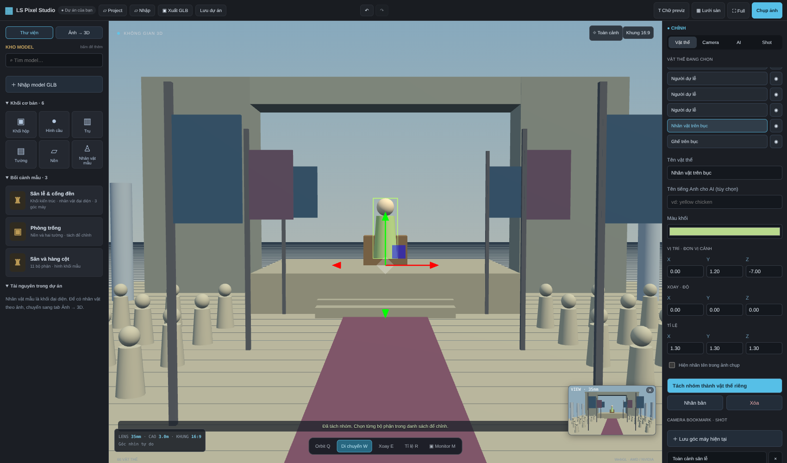

# LS Pixel Studio V3

**[Hướng dẫn V3 đầy đủ](README-V3.md)** — preset bền trong trình duyệt và file sao lưu, tự nhận rig GLB, pose trái/phải độc lập, camera/lens/cảm biến, prompt góc máy và xuất storyboard ZIP. Không cần cài lại thư viện Python khi cập nhật từ V2. AI ảnh/prompt tự do vẫn cần model local và chưa được kiểm chứng inference thực tế; xem các giới hạn trong hướng dẫn.

---

Tài liệu và lịch sử V2 bên dưới.

# LS Pixel Studio V2

V2 bổ sung cách dựng **cảnh mô phỏng bằng nhiều model đại diện** từ bố cục JSON do AI viết, và nhân vật mẫu có khớp để chỉnh tư thế. Đây là một hướng khác với TripoSR/mesh độ sâu; không phải nâng cấp để TripoSR khôi phục chính xác mọi bối cảnh.

## Dùng ngay, không cài thêm AI

1. Cập nhật file V2 vào thư mục cũ, giữ `.venv`, `.cache`, `.data`, `outputs`. Mở `START-STUDIO.bat`.
2. Kho mẫu → **Trạm Sao Hỏa**: mở bố cục dựng sẵn dựa trên ảnh minh họa người dùng, gồm 18 model riêng: địa hình, tháp, mái vòm, ăng ten, tàu, xe, hành tinh và người đại diện. **Đây không phải AI vừa tự phân tích ảnh upload.**
3. Kho **Nhân vật có tư thế** → thêm gà/hà mã/bò/khỉ đột/chibi mẫu, bấm lên sàn để đặt. Chọn nhân vật rồi chỉnh Đứng/Ngồi/Ngồi xổm, cúi thân, hông, gối, tay, khuỷu. Thay đổi được lưu trong `.ls3d` và hình khối đang tạo dáng được xuất GLB. Bộ khớp procedural này chưa phải skeleton chuẩn cho retarget animation.
4. Tab AI → **Nhập bố cục JSON do AI viết**: nhập `scene-studio/examples/characters-poses.json` để mở bộ nhân vật minh họa. Có thể nhập `mars-reference.json` tương tự.
5. Muốn dựng cảnh mới theo ảnh: gửi ảnh cho ChatGPT/Claude kèm `PROMPT-DUNG-CANH-V2.txt`, lấy file JSON trả về rồi nhập vào tool. JSON chỉ là dữ liệu được kiểm tra, không thực thi code do AI viết.

## Tự đọc ảnh ngay trong tool — tùy chọn cần cài thêm

- Cài Ollama từ https://ollama.com/download/windows, mở Ollama.
- Chạy `SETUP-VISION-V2.bat` một lần để tải `qwen2.5vl:3b` (nhiều GB). Hoặc tự chạy `ollama pull qwen2.5vl:3b`.
- Chọn ảnh và chế độ **Bối cảnh mô phỏng theo bố cục**: model thị giác chạy ở Ollama local đọc ảnh thành JSON, tool ghép thư viện khối theo bố cục đó.
- Chế độ **Nhân vật mô phỏng có tư thế** chọn một trong thư viện kiểu dáng đại diện theo ảnh, không giữ chính xác khuôn mặt/quần áo/phụ kiện.
- Chưa xác minh đọc ảnh bằng model Ollama thật ở máy phát triển: không có sẵn Ollama/trọng số. Đã kiểm tra giao thức HTTP với phản hồi giả lập, validation JSON và dựng/render scene thật trong Chromium.
- CPU có thể rất chậm, giới hạn chờ yêu cầu là 15 phút; cần đủ RAM và ổ đĩa cho model, không bảo đảm chạy mượt trên mọi máy. GPU AMD RX 580 không được cam kết tăng tốc. Không bắt buộc Ollama nếu dùng JSON do AI trong chat viết.
- Nếu muốn dùng model Ollama thị giác khác đã cài, đặt biến `LS_VISION_MODEL` trước khi mở studio. Chỉ gọi dịch vụ local `127.0.0.1:11434`, không gửi ảnh tới API trả phí.

## Phân biệt các kết quả

- **Bố cục khối mô phỏng / nhân vật có tư thế**: dựng mô hình đại diện hoàn chỉnh hình khối mọi phía từ thư viện, bố cục/kích thước vẫn ước lượng. Không tự tạo asset tùy ý giống chính xác ảnh. Nhân vật mẫu không phải tài sản gốc của Jenny Pixel Studio.
- **Một nhân vật / đồ vật**: TripoSR dựng mesh từ ảnh một vật đã tách riêng; không có rig và không hợp ảnh cả cảnh. Chưa được bảo đảm chất lượng mặt, tóc, trang phục hoặc bàn tay.
- **Mesh độ sâu · thử nghiệm**: luồng V1 tạo bề mặt nhìn thấy với một số vật TripoSR; có thể rách/méo, không phải scene khối như video.

## Kiểm tra V2

11 test đạt (backend, Unicode Windows giả lập, depth assembler và bố cục). Chromium đã kiểm tra nhập mẫu 18 vật riêng, tư thế thay đổi ma trận khớp thật, lưu/mở lại model có pose, xuất/đọc lại GLB và luồng HTTP trả bố cục với vision model giả lập. **Chưa kiểm tra inference thực tế Ollama/TripoSR trên Windows của người dùng.**

---

Tài liệu editor và luồng cũ bên dưới; với dựng khối theo ảnh, ưu tiên hướng dẫn V2 phía trên.

# LS Pixel Studio V1 — ảnh tham chiếu, model AI và dựng cảnh

Studio web local cho workflow previz: lấy ảnh làm tham chiếu, dựng vật thể AI, bố trí nhân vật và bối cảnh, lưu góc máy, xuất ảnh/GLB.

## Cập nhật V1 — sửa lỗi tiếng Việt trên Windows

Nếu bản cũ báo `UnicodeEncodeError` / `cp1252` / `charmap`, đóng tool và copy file V1 đè vào thư mục cũ. Giữ virtualenv và cache; **không cần cài lại AI**. Mở lại START-STUDIO.bat rồi tạo lại model. V1 cấu hình UTF-8 cho worker và log; không phải sửa lỗi chất lượng model. Đã chạy worker entry point thật với đầu ra cp1252 giả lập và xác nhận Unicode + copy GLB thành công, inference được giả lập trong test.

## Giao diện studio

Bố cục theo video tham khảo: kho model phân nhóm/tìm kiếm ở trái; viewport 3D ở giữa; tab **Vật thể / Camera / AI / Shot** ở phải; thanh **Orbit / Di chuyển / Xoay / Tỉ lệ / Monitor** phía dưới. Monitor là render 16:9 thật của góc camera hiện tại, cập nhật định kỳ; phím M bật/tắt. HUD hiển thị tiêu cự và độ cao. Project mở dự án, Nhập chọn GLB, Xuất tải GLB, Lưu dự án tải `.ls3d`.

Bấm vật thể hoặc tên trong danh sách để hiện gizmo; kéo trục màu để di chuyển, E để xoay và R đổi kích thước. Có viền chọn, nhập thông số, nhãn previz và tên tiếng Anh cho AI. Hoàn tác/làm lại cảnh bằng hai nút trên cùng hoặc Ctrl+Z / Ctrl+Shift+Z (giữ tối đa 10 trạng thái; không hoàn tác camera/bookmark).

Kho có ba cảnh hình khối mẫu, gồm **Sân lễ & cổng đền** với nhân vật đại diện và ba góc máy. Đây là model thủ tục tự dựng, **không phải bộ nhân vật hay tài sản gốc trong video**. Dùng nhập GLB hoặc AI ảnh để thêm tài nguyên của bạn. Nút “Chữ previz” bật nhãn trong viewport và ảnh xuất.

## Mở đúng tool trên Windows

1. Cài **Python 3.11 64-bit** từ python.org, giữ Python Launcher khi cài.
2. Giải nén toàn bộ repository; nhấp **START-STUDIO.bat** ở thư mục ngoài cùng. Giữ cửa sổ lệnh mở. Nếu trình duyệt không tự mở, vào `http://127.0.0.1:8090` trên máy chạy tool.
3. Để dùng AI, chạy **photo-3d-ai/INSTALL-WINDOWS.bat** một lần rồi mở lại studio. Cài AI tải nhiều GB; editor vẫn chạy không cần cài thư viện AI.

## Nhân vật hoặc đồ vật từ ảnh

1. Chuyển sang **Ảnh → 3D**, chọn ảnh PNG/JPG/WEBP dưới 15 MB / 40 triệu pixel.
2. Kéo chuột khoanh một nhân vật/đồ vật, hoặc bấm **Toàn ảnh**.
3. Chọn **Nhân vật / đồ vật**, bấm **Dựng vùng ảnh bằng AI**.
4. Worker thực sự gọi TripoSR trong virtualenv hiện có, tách nền và xuất mesh GLB. Không thay thế bằng ảnh nổi hoặc model mẫu khi AI lỗi. Nếu lỗi, tool hiển thị lỗi để xử lý.
5. Sau khi AI hoàn tất, bấm lên sàn để đặt model. Chọn W/E/R hoặc nhập thông số bên phải để chỉnh.

Phần khuất do AI đoán; model chưa có rig/xương, không có cam kết nhận diện đúng mặt hoặc giữ chính xác trang phục. AI lần đầu tải trọng số từ Hugging Face. Worker dùng CPU cho RX 580 Windows; giảm lưới/chunk không làm model nhỏ đi. Khuyến nghị ít nhất 16 GB RAM, không bảo đảm đủ cho mọi tác vụ.

## Dựng bối cảnh từ toàn ảnh bằng AI

1. Chọn ảnh và loại **Bối cảnh nhiều vật thể**. Bấm **Dựng toàn ảnh bối cảnh bằng AI**; chế độ này dùng toàn ảnh, không dùng vùng khoanh.
2. Depth Anything Small ước lượng độ sâu tương đối. Mask2Former COCO instance tìm các đồ vật nhận diện được. Mỗi vật được đưa qua TripoSR để dựng mesh, rồi đặt theo vị trí/độ sâu ước lượng trong ảnh.
3. Chế độ tiết kiệm dựng tối đa 3 đồ vật; chế độ cao hơn tối đa 6. Các model lần lượt chạy CPU, giải phóng model tách vật/độ sâu trước khi nạp TripoSR. Có thể mất nhiều thời gian và RAM; chưa đo trên RX 580.
4. Các mesh được đưa vào studio thành đối tượng riêng để chọn và kéo ngay. Nền được dựng thành mesh màu theo độ sâu, bỏ bề mặt của các vật đã dựng thành công. Vật lỗi giữ trên nền; trạng thái báo số vật dựng được, số bỏ qua và số lỗi.
5. Chỉnh vị trí/tỉ lệ và thêm model hoặc khối để hoàn thiện. Bấm một vật là hiện trục kéo, chọn E/R để xoay/đổi kích thước. Khung viền xanh xác định vật đang chọn. Nếu model là nhóm, dùng **Tách nhóm**.

**Giới hạn quan trọng:** đây là cảnh 3D **ước lượng từ một góc nhìn**, không phải căn phòng/ngoại cảnh đầy đủ mọi phía. Mesh nền chỉ chứa bề mặt nhìn thấy, có thể bị rách hoặc méo khi nhìn nghiêng; vùng bị che chưa được hoàn thiện. Vật không thuộc các lớp COCO, kiến trúc và đám đông có thể không được tách đúng. TripoSR ước lượng phần sau đồ vật, không bảo đảm giống vật thật. Các vật có thể sai hướng hoặc tỉ lệ, cần chỉnh lại. Kích thước và độ sâu không phải số đo thực tế. Không gọi kết quả này là tái tạo chính xác 360°.

Model bổ sung tải từ Hugging Face: `LiheYoung/depth-anything-small-hf` và `facebook/mask2former-swin-small-coco-instance`; đọc model card và giấy phép trước khi sử dụng. Dependencies đã có trong bộ cài AI; không dùng API trả phí hoặc thay kết quả AI bằng khối mẫu.

## Góc máy, dự án và xuất file

- Kéo trái: orbit; chuột phải: pan; cuộn: zoom. Bấm chọn vật tự hiện gizmo di chuyển. Q: orbit, W: di chuyển, E: xoay, R: tỉ lệ. Các phím tắt không kích hoạt khi đang gõ thông số.
- Chỉnh hướng nắng, tiêu cự; lưu góc máy theo tên. Gọi lại bằng danh sách bên phải.
- Bật nhãn tên từng vật để thêm hướng dẫn trong ảnh chụp; không đưa nhãn vào GLB.
- **Chụp góc máy** xuất PNG 1920×1080, không kèm lưới/gizmo.
- **Xuất GLB** xuất các vật đang hiện, mở trong Blender bằng File → Import → glTF 2.0. GLB có model/màu; camera bookmark và ánh sáng editor không được xuất GLB.
- **Lưu dự án** tải `.ls3d`, chứa hình khối, vật liệu, ảnh và các góc máy. **Mở dự án** để tiếp tục. Không tự lưu: lưu trước khi đóng trang. AI đang chạy bị mất trạng thái giao diện nếu reload; worker vẫn chạy tới khi hoàn tất hoặc server dừng.
- Model GLB nhập được chuẩn hóa cạnh dài khoảng 2 m để dễ đặt; cần chỉnh lại tỉ lệ, không phải số đo thật từ ảnh.

## Máy AMD RX 580

Editor dùng WebGL trên AMD/NVIDIA; không yêu cầu CUDA. AI chạy CPU riêng, có thể chậm nhiều phút và dùng nhiều RAM. Không giả lập hỗ trợ CUDA/DirectML trên RX 580. Đóng app khác khi dựng AI. Worker thoát sau mỗi lần tạo để trả bộ nhớ cho hệ điều hành. Kết quả/ảnh xử lý ở `scene-studio/.data/`, các bản xuất engine ở `photo-3d-ai/outputs/`; có thể xóa khi không cần.

## Kiểm tra và giới hạn xác minh

Đã kiểm tra bằng Chromium headless: thêm khối/bối cảnh, đặt vật thể, đổi mode, nhập thông số, bookmark, lưu/mở lại dự án có texture, nhập/xuất GLB và xuất PNG. Không có lỗi JavaScript trong luồng kiểm tra. Sáu test backend/ghép cảnh kiểm tra routes, input, hàng đợi, và báo kết quả/lỗi worker với subprocess giả lập; kiểm tra phép chiếu depth và xuất cảnh có các node riêng với dự đoán AI giả lập. Engine TripoSR có ba test adapter/pipeline riêng với inference giả lập.

**Chưa xác minh inference AI thật, chất lượng model, hiệu năng RX 580 hoặc Windows:** máy cloud không có GPU và bị chặn Hugging Face HTTP 403. Kiểm tra phần editor không chứng minh inference chạy thành công trên máy người dùng. Nếu AI báo lỗi tải model, kiểm tra Internet tới Hugging Face và các host tải trọng số; không tắt TLS.

Linux chạy editor bằng `python scene-studio/server.py` từ gốc repository. Chạy test bằng Python trong virtualenv AI đã cài: `.venv-photo3d/bin/python -m unittest discover -s scene-studio/tests -v` (trên Windows thay executable bằng `photo-3d-ai\.venv\Scripts\python.exe`). Engine AI cần Python và dependencies hướng dẫn trong `photo-3d-ai/README.md`.

Three.js 0.180.0 MIT nằm trong `vendor/`, giữ giấy phép THREE-LICENSE.txt. Engine TripoSR và giấy phép được lưu ở `photo-3d-ai/`.

Kiểm tra bổ sung: đã thử kéo trục X bằng chuột trong Chromium, xác nhận tọa độ vật thể đổi và Undo trả về tọa độ cũ; kiểm tra tab inspector, tìm model, tách sân lễ thành các đối tượng riêng, ba bookmark, Undo/Redo, monitor, nhãn, PNG và lưu/mở dự án. Luồng toàn ảnh → HTTP job → nhiều mesh độc lập được kiểm tra với phản hồi AI giả lập. Hai kiến trúc model mới import được trong bộ dependencies đã cài; **chưa tải trọng số hoặc chạy inference thật** vì giới hạn mạng đã nêu.
